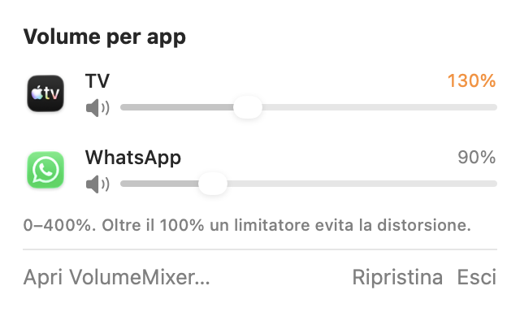
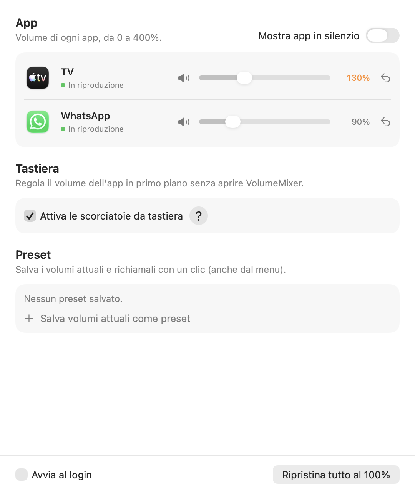

# VolumeMixer

*[Read in English](README.md)*

Una piccola app per la barra dei menu di macOS che permette di regolare **il volume di ogni app separatamente**.

L'ho creata per guardare una serie insieme ad altre persone durante una videochiamata: la chiamata si sentiva sempre molto più forte della serie. Con VolumeMixer puoi abbassare la chiamata e alzare la serie, anche da tastiera mentre guardi la serie.

<p>
  
  
</p>

## Funzioni

- **Un cursore per ogni app**, da 0 a 400%. Sopra il 100% un limitatore evita la distorsione.
- **Scorciatoie da tastiera**: **⌃⌥↑ / ⌃⌥↓** (Control + Option + freccia) alzano o abbassano del 5% il volume dell'app in primo piano; tenendoli premuti il volume continua a cambiare. **⌃⌥← / ⌃⌥→** scelgono un'altra app che sta suonando: finché l'indicatore è visibile, ⌃⌥↑ / ⌃⌥↓ regolano quell'app senza portarla in primo piano, così puoi abbassare la chiamata senza uscire da un video a schermo intero. Un piccolo indicatore in alto mostra il nuovo livello, anche sopra i video a schermo intero. I tasti del volume del Mac continuano a funzionare come sempre. Nella finestra principale puoi disattivarle, e il pulsante **?** accanto alla casella le spiega.
- **Preset**: salva i volumi attuali e richiamali con un clic.
- **Ricorda i volumi** di ogni app e li riapplica quando l'app torna a suonare.
- Si adatta da sola quando cambia l'uscita audio (per esempio se colleghi le cuffie).
- Al 100% l'app non tocca l'audio.
- Finestra principale più un pannello compatto nella barra dei menu; avvio al login opzionale.

L'interfaccia è in **italiano e inglese** e segue la lingua del sistema. Per scegliere una lingua diversa solo per VolumeMixer: Impostazioni di Sistema → Generali → Lingua e Zona → Applicazioni.



## Requisiti

- macOS **14.4** o successivo (Apple Silicon o Intel)

## Installazione

### Opzione A: download

1. Scarica `VolumeMixer-x.y.z.zip` dalla pagina [Releases](../../releases) ed estrailo.
2. Sposta `VolumeMixer.app` nella cartella Applicazioni.
3. L'app non è firmata con un Developer ID di Apple, quindi al primo avvio macOS la blocca. Per sbloccarla, prova ad aprirla una volta, poi vai in **Impostazioni di Sistema → Privacy e sicurezza** e clicca **Apri comunque**. Va fatto una volta sola.

### Opzione B: compilarla da sé

Bastano gli strumenti da riga di comando di Xcode (`xcode-select --install`), non serve Xcode.

```sh
git clone https://github.com/petruzzellabeatrice/VolumeMixer.git
cd VolumeMixer
./build.sh
```

L'app viene compilata e installata in `~/Applications/VolumeMixer.app`. Con `./build.sh --release` crei invece uno zip universale in `dist/`.

## Primo avvio

La prima volta che cambi il volume di un'app, macOS chiede il permesso di **registrare l'audio di sistema**. Serve per catturare il suono dell'app: VolumeMixer non registra e non invia nulla. Se l'hai negato per sbaglio, attivalo in **Impostazioni di Sistema → Privacy e sicurezza → Registrazione dello schermo e dell'audio di sistema**.

## Come funziona

Usa i **process tap** di Core Audio, disponibili da macOS 14.4. Per ogni app con un volume diverso dal 100%, VolumeMixer:

1. crea un tap sui processi audio dell'app, zittendo il suono originale;
2. crea un dispositivo aggregato privato che unisce il tap e l'uscita audio attuale;
3. riproduce l'audio catturato con il volume scelto, con una rampa graduale per evitare click e un limitatore sopra il 100%.

Il codice è in `Sources/`:

| File | Cosa fa |
|---|---|
| `AudioTap.swift` | Core Audio: elenco dei processi audio, tap, dispositivo aggregato e funzione di rendering |
| `Mixer.swift` | Stato: app in riproduzione, volumi, preset, volume da tastiera |
| `MenuView.swift` | Pannello della barra dei menu e componenti condivisi |
| `MainWindow.swift` | Finestra principale |
| `HotKeys.swift` | Scorciatoie globali ⌃⌥ + frecce |
| `VolumeHUD.swift` | Indicatore del volume a schermo |
| `App.swift` | Avvio dell'app |

## Limiti noti

- **Le schede di Safari non si possono separare**: tutte usano un unico processo audio. Le *web app* di Safari (File → Aggiungi al Dock) invece hanno un processo proprio, quindi ognuna ha il suo cursore. Lo stesso vale per Chrome.
- Quando un'app apre un nuovo processo audio (per esempio all'inizio di una chiamata), può suonare al volume originale per al massimo un secondo prima di essere intercettata.
- Durante le chiamate macOS abbassa l'audio delle altre app e la cancellazione dell'eco può attenuare il suono che esce dagli altoparlanti. VolumeMixer compensa in parte, ma con le cuffie si sente meglio.
- Per collegare i processi di supporto alla loro app (per esempio `WebKit.GPU` a Safari) usa la funzione privata `responsibility_get_pid_responsible_for_pid`. Funziona, ma non è un'API pubblica.

## Licenza

Dalla versione 1.3.0 VolumeMixer è distribuita con la [PolyForm Noncommercial License 1.0.0](LICENSE): puoi usarla, studiarla, modificarla e condividerla gratuitamente, purché non a scopo commerciale. Per venderla o usarla commercialmente serve una licenza a parte: [apri una issue](https://github.com/petruzzellabeatrice/VolumeMixer/issues) per chiederla.

Le versioni fino alla 1.2.0 comprese sono state distribuite con licenza MIT e restano disponibili con quella licenza.

Questo progetto non è affiliato ad Apple, WhatsApp o alle altre app citate.
