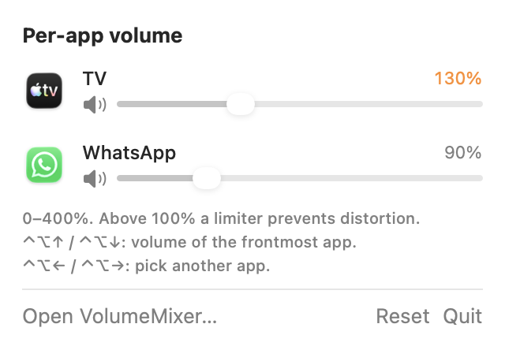
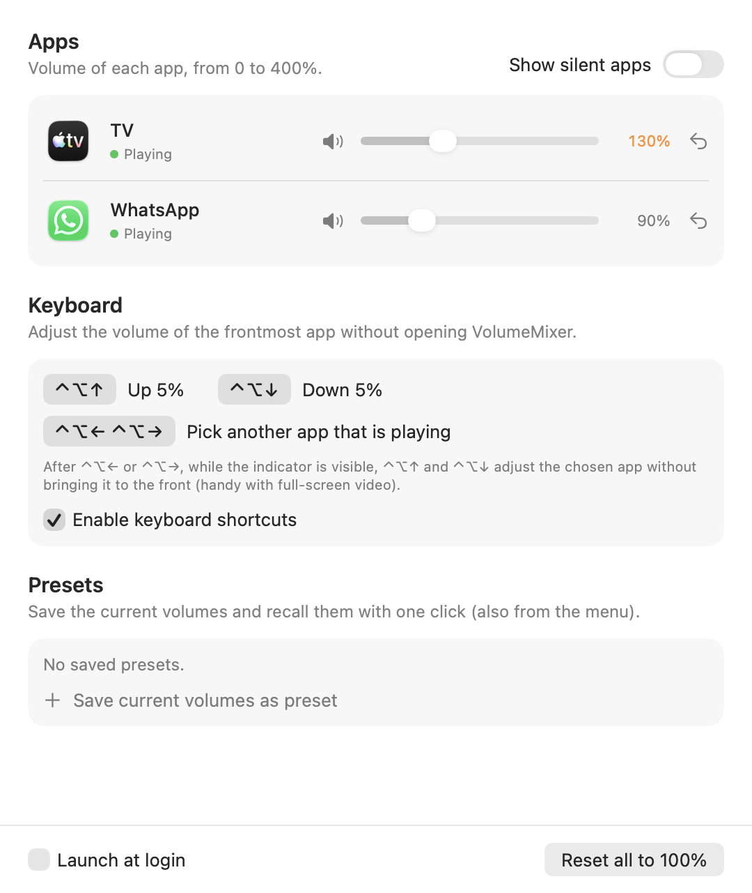

# VolumeMixer

*[Leggi in italiano](README.it.md)*

A small macOS menu bar app that lets you set the **volume of each app separately**.

I built it for watching a series together while on a video call: the call was always much louder than the show. With VolumeMixer you can turn the call down and the show up, even from the keyboard while the show is playing.

<p>
  
  
</p>

## Features

- **One slider per app**, from 0 to 400%. Above 100% a soft limiter keeps the sound from distorting.
- **Keyboard shortcuts**: **⌃⌥↑ / ⌃⌥↓** (Control + Option + arrow) raise or lower the volume of the frontmost app by 5%; hold them to keep going. **⌃⌥← / ⌃⌥→** pick another app that is playing: while the indicator is visible, ⌃⌥↑ / ⌃⌥↓ adjust that app without bringing it to the front, so you can turn down the call without leaving a full-screen video. A small indicator at the top of the screen shows the new level, even over full-screen video. The Mac's own volume keys keep working as usual. The shortcuts can be turned off in the main window.
- **Presets**: save the current volumes and recall them with one click.
- **Remembers your volumes** for each app and reapplies them when the app starts playing again.
- Follows output changes (for example plugging in headphones).
- At 100% the app does not touch the audio at all.
- Main window plus a compact menu bar panel; optional launch at login.

The interface is in **English and Italian** and follows your system language. To choose a different language for VolumeMixer only, go to System Settings → General → Language & Region → Applications.



## Requirements

- macOS **14.4** or later (Apple Silicon or Intel)

## Installation

### Option A: download

1. Download `VolumeMixer-x.y.z.zip` from the [Releases](../../releases) page and unzip it.
2. Move `VolumeMixer.app` to your Applications folder.
3. The app is not signed with an Apple Developer ID, so macOS will block it on first launch. To allow it, open it once, then go to **System Settings → Privacy & Security** and click **Open Anyway**. You only have to do this once.

### Option B: build from source

You only need the Xcode Command Line Tools (`xcode-select --install`), not Xcode itself.

```sh
git clone https://github.com/petruzzellabeatrice/VolumeMixer.git
cd VolumeMixer
./build.sh
```

This compiles the app and installs it to `~/Applications/VolumeMixer.app`. Use `./build.sh --release` to create a universal zip in `dist/` instead.

## First launch

The first time you change an app's volume, macOS asks for permission to **record system audio**. This is needed to capture the app's sound; VolumeMixer does not record or send anything anywhere. If you denied it by mistake, enable it in **System Settings → Privacy & Security → Screen & System Audio Recording**.

## How it works

It uses Core Audio **process taps**, available since macOS 14.4. For each app whose volume is not 100%, VolumeMixer:

1. creates a tap on that app's audio processes, muting the original sound;
2. creates a private aggregate device that combines the tap with the current output device;
3. plays the captured audio back with the chosen gain, using a smooth ramp to avoid clicks and a soft limiter above 100%.

The code is in `Sources/`:

| File | What it does |
|---|---|
| `AudioTap.swift` | Core Audio: listing audio processes, the tap, the aggregate device and the render callback |
| `Mixer.swift` | State: which apps are playing, volumes, presets, keyboard volume changes |
| `MenuView.swift` | Menu bar panel and shared UI components |
| `MainWindow.swift` | Main window |
| `HotKeys.swift` | Global ⌃⌥ + arrow shortcuts |
| `VolumeHUD.swift` | On-screen volume indicator |
| `App.swift` | App entry point |

## Known limitations

- **Safari tabs can't be controlled separately**: all tabs share a single audio process. Safari *web apps* (File → Add to Dock) do have their own process, so each one gets its own slider. The same applies to Chrome.
- When an app opens a new audio process (for example at the start of a call), there may be up to one second at the original volume before the new process is picked up.
- During calls, macOS lowers other apps' audio and echo cancellation can suppress sound coming from the speakers. VolumeMixer can make up for this in part, but headphones still work best.
- To attribute helper processes to their app (for example `WebKit.GPU` to Safari), it uses the private function `responsibility_get_pid_responsible_for_pid`. This works, but it is not a public API.

## License

[MIT](LICENSE)

This project is not affiliated with Apple, WhatsApp or any other app mentioned.
